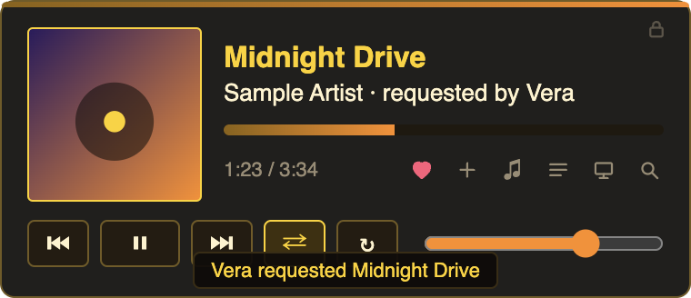
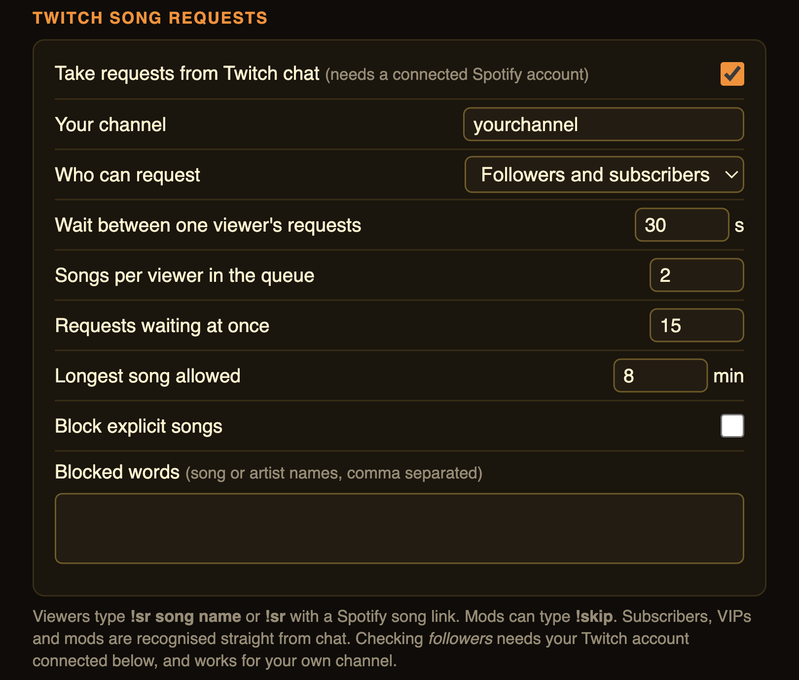

# Rogue Radio Overlay

[](https://github.com/ShawnGoff/RogueRadio/actions/workflows/test.yml)
[](LICENSE)

A small always-on-top Spotify controller for your desktop. It floats above games and other
apps, shows what's playing, and gives you clickable controls plus global keyboard shortcuts.
Everything runs on your own computer; your Spotify login never leaves it.



*The overlay, with a song requested from Twitch chat. (Sample track and a simulated request, for the picture.)*

**[Download for Mac](https://github.com/ShawnGoff/RogueRadio/releases/latest)** (unsigned: right-click the app and choose Open the first time).

## Features

- Album art, song, artist, progress bar (click to seek) and volume
- Play/pause, previous/next, shuffle, repeat
- Like (heart) and add to playlist
- A separate **Search & Play** window: search songs, artists, albums, playlists, podcasts, episodes and audiobooks (filter chips, and "Show more" for further pages), play them, or play one of your own playlists
- Panels for lyrics, playlists, your queue (click a song to skip to it), and Spotify devices
- Lyrics from [LRCLIB](https://lrclib.net), synced when timed lyrics exist
- Mini mode, auto-hide, opacity, size, start at login
- When you quit, it can offer to close Spotify too (ask, always, or never; set in Settings)
- Global keyboard shortcuts you can change in Settings
- Click-through when you aren't using it; a lock keeps it in place until you want to move it

Controls that change playback need **Spotify Premium** and an active Spotify device.

## Two ways to use it

**No account needed (macOS).** Just open Spotify and start the overlay. It controls the Spotify app on your Mac: play/pause, previous/next, seek, volume, shuffle, repeat, lyrics and what's playing. No Spotify login, no developer app, and none of Spotify's web-API user limits. macOS asks once to let the overlay control Spotify (System Settings > Privacy & Security > Automation).

**With your Spotify account.** Connecting an account adds likes, adding to playlists, search, your queue, devices, and playing playlists/podcasts/audiobooks. This uses Spotify's web API, so it needs a Spotify app of your own (below) and Spotify Premium. Spotify limits how many people can use one such app, so each person connects with their own.

## Connecting your account (optional)

1. Create a Spotify app at <https://developer.spotify.com/dashboard>.
   Add the redirect URI `http://127.0.0.1:3333/api/auth/callback` (Spotify requires `127.0.0.1`).
   Note: since February 2026, new Spotify apps need the app owner to have Premium and are limited to 5 users.
2. Create `~/.rogue-radio-overlay/.env` containing:
   ```
   SPOTIFY_CLIENT_ID=your_client_id
   SPOTIFY_CLIENT_SECRET=your_client_secret
   SPOTIFY_REDIRECT_URI=http://127.0.0.1:3333/api/auth/callback
   ```
3. Start the app, click the menu bar icon, and choose **Connect Spotify account**.

To go back to no-account mode, choose **Disconnect Spotify account** in the menu bar menu or in Settings.

## Twitch song requests (optional)

Viewers can add songs to your Spotify queue from Twitch chat. It needs your Spotify account connected (adding to the queue isn't possible in no-account mode).

1. In **Settings > Twitch song requests**, turn it on and enter your channel name.
2. Pick who can request: followers and subscribers (default), subscribers only, everyone, or mods only.
3. Viewers type `!sr song name` or `!sr` plus a Spotify song link. Mods and you can type `!skip`.

Subscribers, VIPs and mods are recognised straight from chat, with no Twitch login. Checking **followers** needs your Twitch account connected once: register a free app at [dev.twitch.tv/console](https://dev.twitch.tv/console) with Client Type **Public** (redirect URL `http://localhost`), paste its Client ID into Settings and click **Connect Twitch**. Only the "read followers" permission is requested, and it works for your own channel.

Limits you can set: wait between one viewer's requests, songs per viewer, requests waiting at once, longest song, explicit songs, and a blocked-words list. The overlay shows "requested by NAME" on the current song and in the queue list. The app only reads chat, so it doesn't reply in chat. Twitch can mute VODs that contain copyrighted music; that is up to you to manage.



## Moving and resizing the overlay

**Resize:** hover the overlay and drag the small handle in its **bottom-right corner**. Double-click the handle to reset to 100%. You can also use **Settings → Size** (80% to 200%). Resizing works any time, even while the position is locked.

**Move:** the overlay starts **locked** so it can't be dragged by accident. Click the small lock in its top-right corner to unlock it, then drag it from any empty spot (the lock turns gold and a dashed outline shows it's movable). Click the lock again to lock it. **Hold Shift and drag** to move it at any time, even while locked.

## Default shortcuts (Ctrl + number pad)

Hold **Ctrl** and press a number-pad key (keep Num Lock on). No Alt/Option key needed.

| Key | Action | Key | Action |
|---|---|---|---|
| Num 0 | Play / pause | Num 5 | Like / unlike |
| Num 6 / Num 4 | Next / previous | Num 7 | Lyrics panel |
| Num 8 / Num 2 | Volume up / down | Num 9 | Add-to-playlist panel |
| Num / | Shuffle | Num 1 | Queue panel |
| Num * | Repeat | Num 3 | Devices panel |
| Num + | Show / hide overlay | Num - | Mini mode |
| Num . | Search & Play window | | |

No number pad? In **Settings**, switch the shortcut set to **Alt + Shift + letters** (for example Alt+Shift+Space for play/pause, Alt+Shift+F for Search & Play), or click **Change** on any row to record your own.

## How it's built

- **Overlay (`overlay/`)**: an Electron app. A frameless, transparent, always-on-top window that is click-through until the cursor is over it; the main process owns settings, global shortcuts, the tray and the Search & Play window, and talks to the server over a local REST API.
- **Local server (`src/`)**: a small Express server bound to `127.0.0.1` that rejects any request carrying a browser Origin header. It controls Spotify two ways: the Spotify Web API (OAuth, with token refresh and device fallback) when an account is connected, or AppleScript on macOS when it isn't. Lyrics come from LRCLIB with a local cache.
- **Twitch song requests (`overlay/src/twitch-*.js`, `requests.js`)**: an anonymous read-only IRC client over TLS (no dependency) feeds a rules engine (access level, cooldowns, limits, blocklist). Follower checks use Twitch's device-code sign-in, so no client secret or redirect page is needed.
- **Tests**: Node's built-in test runner with a mocked Spotify and Twitch, a local fake IRC server, and a real AppleScript compile check. GitHub Actions runs them on every push.

## Development

```bash
cd src && npm install          # the local Spotify server
cd ../overlay && npm install
npm start                      # runs the overlay; it starts the server for you
npm run dist                   # builds the macOS installer into overlay/dist
```

Tests: `cd src && npm test` (server, with a mocked Spotify that never touches your account) and `cd overlay && npm test`.

Prebuilt Mac downloads are on the [Releases page](https://github.com/ShawnGoff/RogueRadio/releases). Builds are unsigned, so macOS may ask you to right-click the app and choose Open the first time. Windows isn't supported yet; the no-account mode relies on AppleScript, so it is Mac-only.

## Where things are stored

`~/.rogue-radio-overlay/` holds your `.env`, Spotify login tokens (`tokens.json`),
overlay settings and the lyrics cache. Earlier versions used `~/.azeroth-radio/`; it's moved
automatically on first launch.

## Troubleshooting

The app writes a small log to `~/.rogue-radio-overlay/overlay.log` (what it tried when you quit, errors talking to the local server, and so on). Include it when reporting a problem.

## Notes on podcasts and audiobooks

- Audiobooks are only available in the US, UK, Canada, Ireland, New Zealand and Australia.
- Spotify's documentation only describes songs, albums, artists and playlists as playable from the API. Podcasts and audiobooks are tried directly first and, if Spotify refuses, the newest episode or the first chapter is started instead.

## License

[PolyForm Noncommercial 1.0.0](LICENSE): free to use, modify and share for noncommercial purposes. You may not sell it or use it commercially.

## Credits

Lyrics provided by LRCLIB. Not affiliated with, endorsed by or sponsored by Spotify or Twitch; those names belong to their owners.
